# JomiReady — Digital Land Verification & Case Management

JomiReady is a web-based prototype designed to organize land verification workflows, manage verification cases, and track supporting evidence through a staff dashboard.

The project aims to make land-related verification workflows more organized, accessible, and transparent in the context of Bangladesh.

> **Project status:** Prototype developed for the DIU LandTech Hackathon.

## Problem Statement

Land-related verification can involve reviewing multiple documents, checking property information, and managing supporting evidence. Poorly organized workflows can make these tasks difficult to track and review.

JomiReady explores a digital approach to organizing verification requests, case information, and evidence management in one interface.

## Key Features

- **Land Verification Form:** Submit land-related information for review.
- **Verification Results:** Display the result produced by the current prototype.
- **Staff Dashboard:** View and manage verification cases.
- **Evidence Management:** Add supporting evidence and update evidence status.
- **Case Tracking:** Review case information and available status indicators.
- **Data Persistence:** Preserve supported application data across page refreshes using the current implementation.
## Screenshots

### 1. Homepage

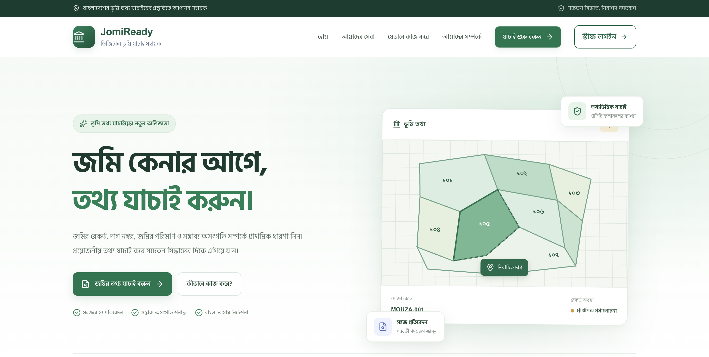

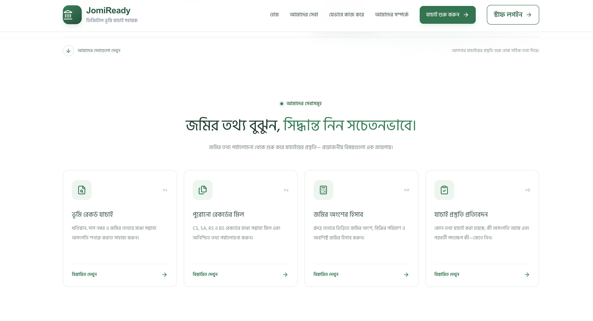

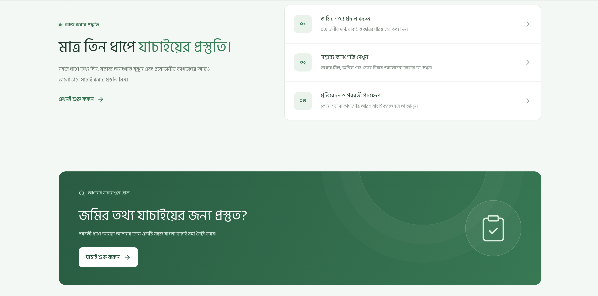

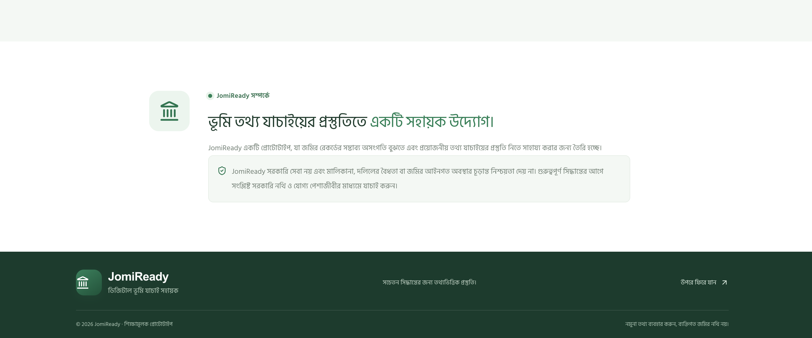

### 2. Land Verification

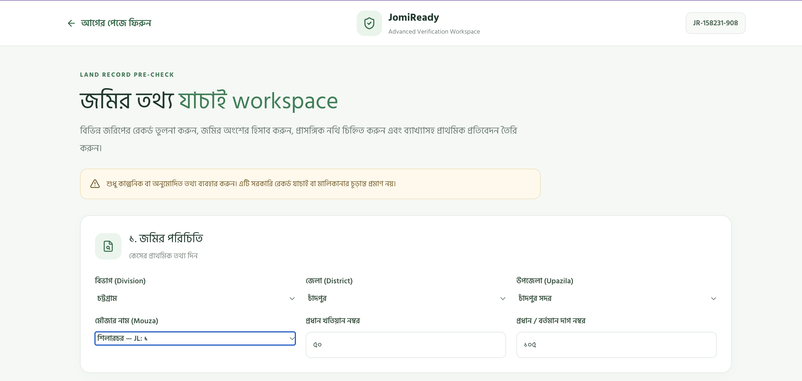

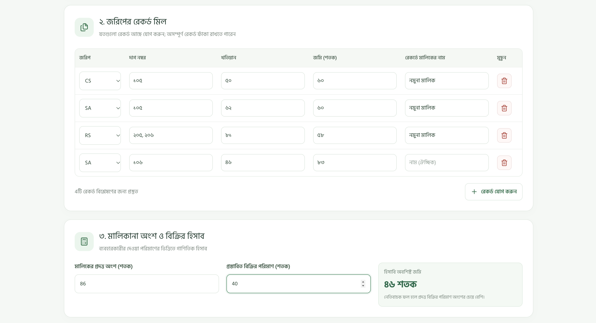

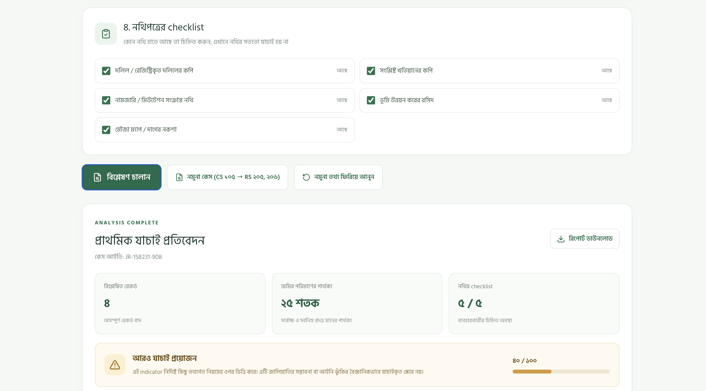

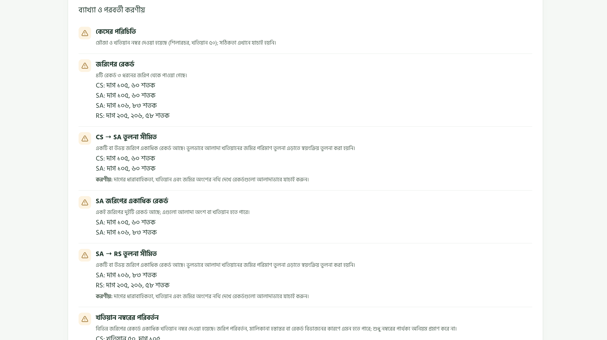

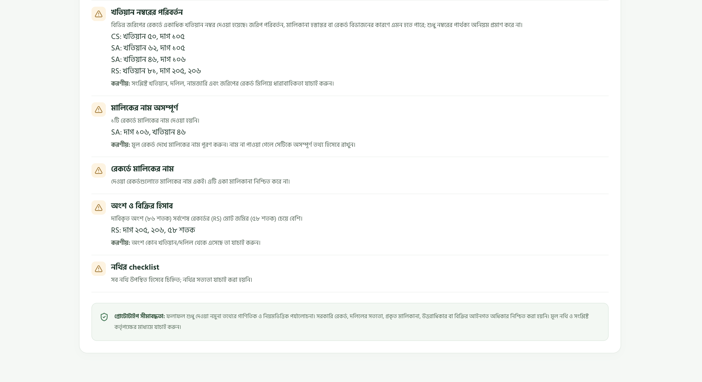

### 3. Staff Dashboard

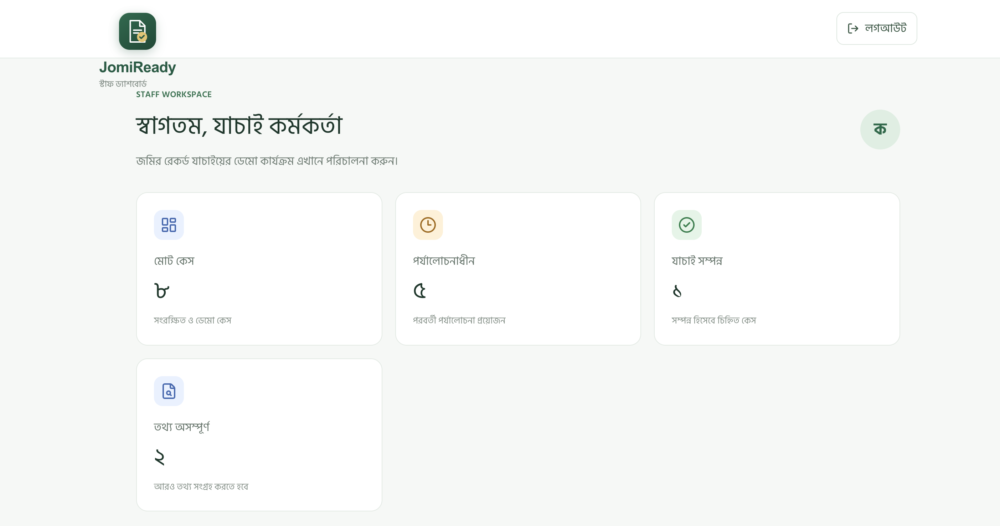

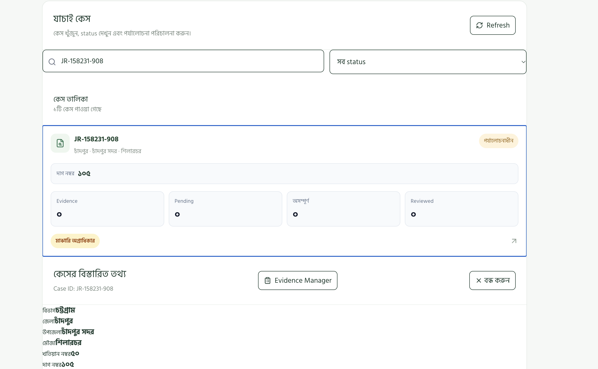

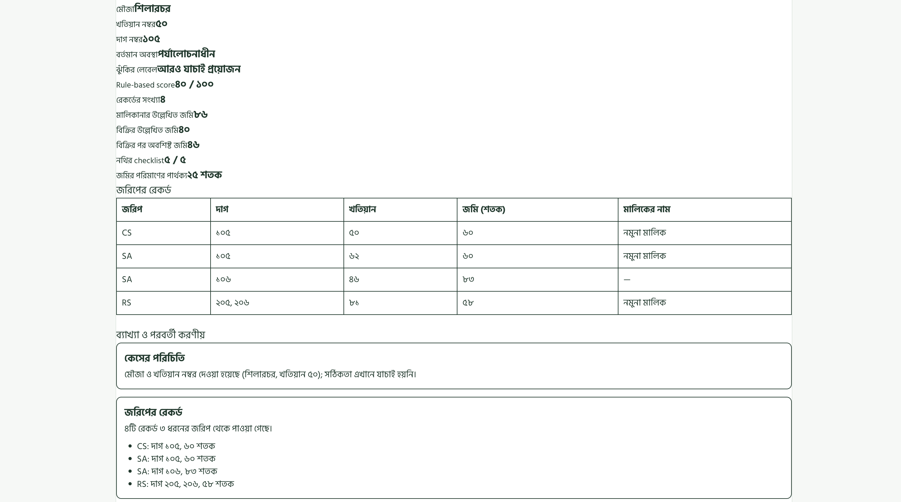

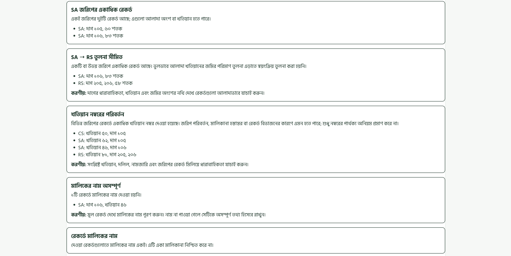

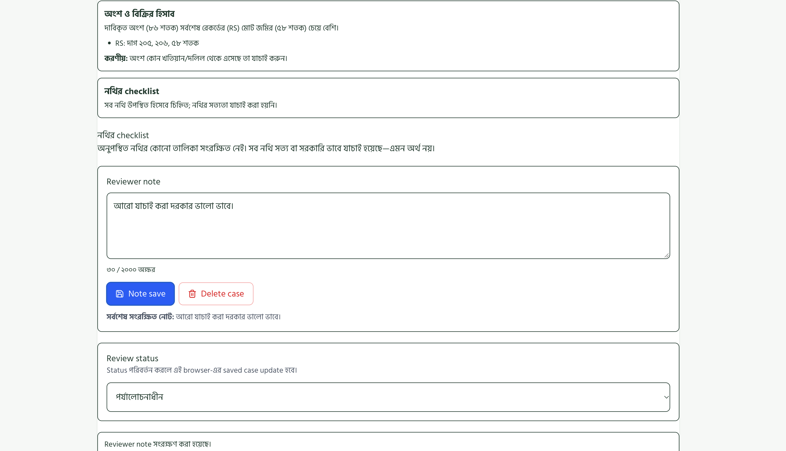

### 4. Evidence Manager

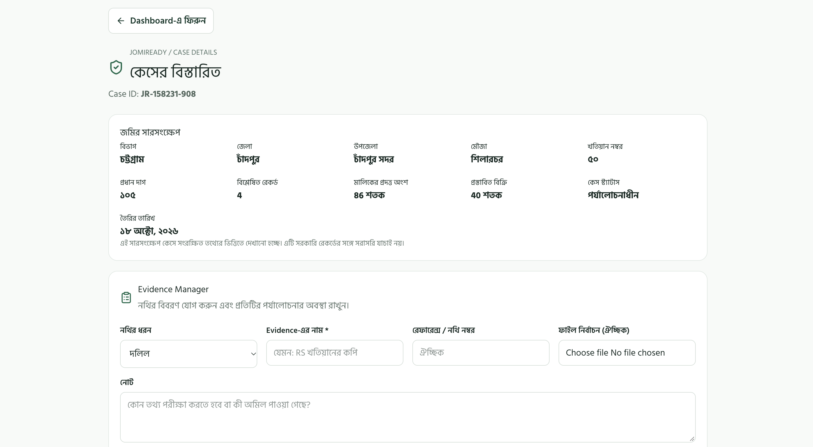

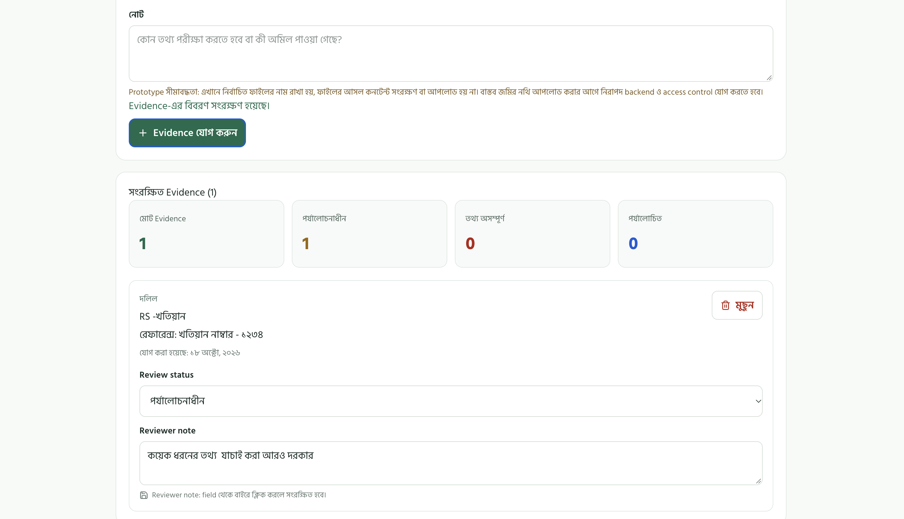


## Technology Stack

- React
- Vite
- JavaScript
- CSS
- Lucide React icons

## Getting Started

### Prerequisites

Install the following before running the project:

- Node.js
- npm
- Git

### Installation

Clone the repository:

```bash
git clone git clone https://github.com/jonayedhasan884/jomiready.git
```

Move into the project directory:

```bash
cd jomiready
```

Install dependencies:

```bash
npm install
```

Start the development server:

```bash
npm run dev
```

Open the local URL shown in your terminal.

### Production Build

To create a production build, run:

```bash
npm run build
```

To preview the production build locally:

```bash
npm run preview
```

## Project Structure

```text
jomiready/
├── public/
├── src/
│   ├── components/
│   ├── pages/
│   ├── utils/
│   ├── App.jsx
│   ├── main.jsx
│   └── index.css
├── index.html
├── package.json
├── package-lock.json
└── README.md
```

The exact contents may vary as the project evolves.

## Prototype Limitations

- The prototype should not be treated as an official government land-record verification service.
- Official ownership confirmation requires verification against authorized and reliable land-record sources.
- Features and data persistence depend on the current implementation.
- Demo data should not be interpreted as verified real-world land ownership information.

## Future Improvements

- Integration with authorized land-record services, where permitted.
- Stronger authentication and role-based access control.
- Secure database storage and audit logs.
- Document integrity checks and verification history.
- Improved reporting and case tracking.

## Hackathon

**Track:** Digital Land Records, Verification & Digitization  
**Project:** JomiReady

Built as a prototype exploring a more organized digital land verification and case management workflow for Bangladesh.
